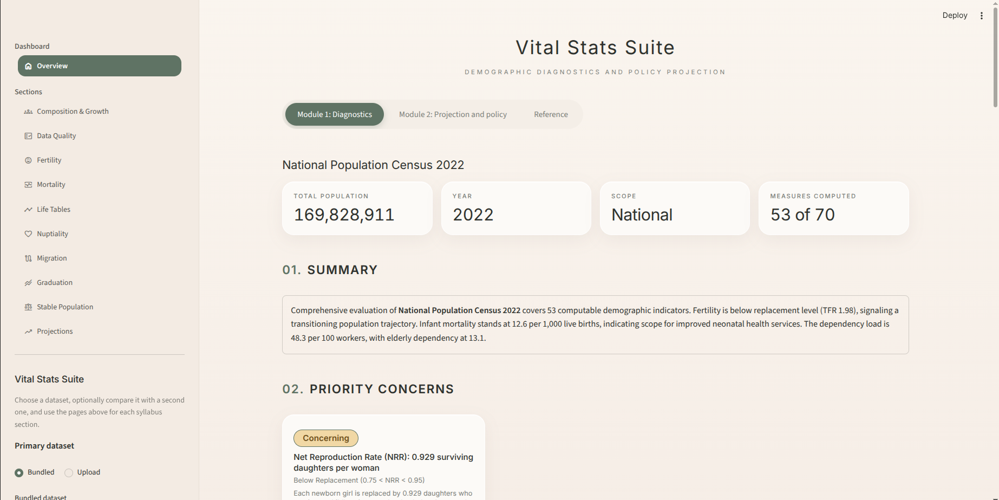
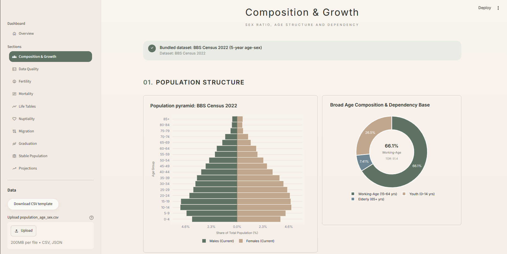
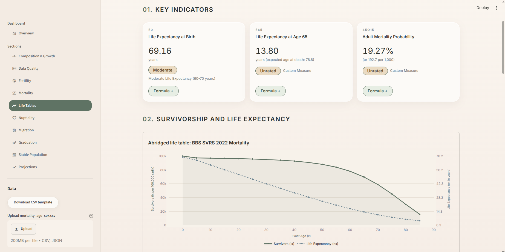

# Vital Stats Suite   
**A Demography Bashboard**

A demographic intelligence suite and policy engine. It ingests census or vital-registration data, runs data-quality audits (Whipple's Index, Myers' Index, UN age-sex score, PEC coverage), computes a battery of demographic measures (about **70 computed straight from a dataset**, plus calculators for the rest of the class revision sheet), rates the results against international benchmarks (UN/WHO/CDC), projects future population trajectories, and drafts policy recommendations.

Every measure card shows its value, unit, benchmark status, a **LaTeX formula**, and a plain-language reading in the form `MP = 49.58 : Roughly 49.58% of the population is male. The remaining 50.42% is female.`

---

  

---

## ⚡ Quickstart

You need **Python 3.9 or newer**. Run everything from the project's root folder (the one that contains `app.py` and `requirements.txt`).

### 1. Create a virtual environment (recommended)

```bash
python3 -m venv .venv
```

Activate it:

| System | Command |
|---|---|
| macOS / Linux | `source .venv/bin/activate` |
| Windows (PowerShell) | `.venv\Scripts\Activate.ps1` |
| Windows (Command Prompt) | `.venv\Scripts\activate.bat` |

You can skip this step and install into your system Python, but a virtual environment keeps the project's packages separate.

### 2. Install the dependencies

```bash
pip install -r requirements.txt
```

> The `-r` matters. It tells pip to read the package names *from* the file. Writing `pip install requirements.txt` (no `-r`) fails, because pip treats it as a package called "requirements.txt".

On some Linux systems `pip` is `pip3`. On Ubuntu with a system-managed Python, either use a virtual environment (step 1) or add `--break-system-packages`.

`requirements.txt` installs: `streamlit` (1.46 or newer), `pandas`, `numpy`, `plotly`, `reportlab`, `requests` and `matplotlib` (draws the LaTeX formulas).

### 3. Run the app

```bash
streamlit run app.py
```

Streamlit prints a local address and normally opens your browser. If it doesn't, go to **http://localhost:8501**.

Equivalent shortcut, if you prefer plain Python:

```bash
python3 app.py
```

To use a different port: `streamlit run app.py --server.port 8600`. To stop the app, press `Ctrl + C` in the terminal.

### 4. Run the automated tests (optional)

```bash
pip install pytest
python3 -m pytest tests/
```

About 250 tests: engine formulas against worked examples, loaders, exports, LaTeX rendering, regression tests, and a smoke test that loads every page with every bundled dataset. The full run takes roughly 30–40 seconds.

### Troubleshooting

| Problem | Fix |
|---|---|
| `ModuleNotFoundError: engine` or `ui` | You are not in the project root. `cd` to the folder that contains `app.py` and run again. |
| `ModuleNotFoundError: streamlit` (or another package) | The virtual environment is not active, or step 2 was skipped. Activate it and rerun `pip install -r requirements.txt`. |
| `AttributeError` about `st.navigation` or `st.html` | Streamlit is too old. Run `pip install --upgrade "streamlit>=1.46"`. |
| "Bundled dataset … is missing" | Run `python3 sample_data/generate_samples.py` to regenerate the sample files. |
| "Port 8501 is already in use" | Another Streamlit app is running. Stop it, or use `--server.port` with a different number. |
| A formula shows as plain text instead of typeset math | `matplotlib` is missing or broken. Reinstall with `pip install -r requirements.txt`. The card still works; only the formula's look changes. |

---

## 🏛️ System Architecture

```
vital-stats-suite/
├── app.py                      # Entry point: navigation (run this)
├── home.py                     # Overview page: Module 1 diagnostics, Module 2 projection, reference
├── requirements.txt            # Python dependencies (pip install -r requirements.txt)
├── pyproject.toml              # Project metadata and test configuration
├── README.md                   # This guide
├── ENGINE.md                   # Formula and citation manual (shown in the Reference tab)
├── DATA.md                     # Data sources and provenance
├── .streamlit/config.toml      # Theme colours for native Streamlit widgets
|
├── engine/                     # Core demographic calculation engine
│   ├── base.py                 # Data models (DemographicDataset, DemographicMeasureResult), standard populations
│   ├── registry.py             # Measure catalogue: names, units, formulas, plain-language interpretations
│   ├── formulas.py             # LaTeX formula for every measure + SVG renderer
│   ├── extra_measures.py       # Measures from the class revision sheet + calculator definitions
│   ├── sex_composition.py      # Sex composition (MP, SR, SRB, Excess of Males)
│   ├── age_dependency.py       # Age structure & dependency (ACR, TDR, OADR, median age, percentage distribution…)
│   ├── fertility.py            # CBR, GFR, ASFR, TFR, GRR, NRR, MAC, Bongaarts framework
│   ├── mortality.py            # CDR, IMR, NMR, U5MR, MMR, ASDR, direct/indirect standardization
│   ├── lifetable.py            # Abridged and complete life tables, cause elimination, working life
│   ├── nuptiality.py           # SMAM, spousal age gap, marriage and divorce rates
│   ├── migration.py            # Migration rates, balancing equation, origin-destination matrix
│   ├── graduation.py           # Sprague, Karup-King-type and Beers-type graduation, smoothing
│   ├── stable.py               # Lotka intrinsic r, b, d, T, quadratic approximation, momentum
│   ├── transition.py           # Demographic transition stage classifier
│   ├── projection.py           # Cohort-component projection and policy flags
│   ├── inference.py            # Module 2 entry point (trajectory simulation)
│   ├── quality.py              # Whipple, Myers, UN joint score, PEC, completeness checks
│   ├── interpretation.py       # UN/WHO benchmark bands and gauge parameters
│   ├── loader.py               # CSV/JSON loader that recognises what kind of table a file is
│   ├── schemas.py              # CSV schemas and downloadable templates
│   ├── missing_assistant.py    # Missing-data explanations (built-in + optional Gemini)
│   └── pipeline.py             # Orchestrator and two-dataset comparison
|
├── pages/                      # One page per syllabus section
│   ├── 1_Composition_and_Growth.py
│   ├── 2_Data_Quality.py
│   ├── 3_Fertility.py
│   ├── 4_Mortality.py
│   ├── 5_Life_Tables.py
│   ├── 6_Nuptiality.py
│   ├── 7_Migration.py
│   ├── 8_Graduation.py
│   ├── 9_Stable_Population.py
│   └── 10_Projections.py
|
├── ui/                         # Visual layer
│   ├── theme.py                # Calm Kit design system: CSS, measure cards, pills, grids
│   ├── data_sources.py         # Shared upload / template / bundled-dataset sidebar
│   ├── calculators.py          # Calculator panels for input-driven measures
│   └── components.py           # Pyramid, gauges, trajectory and schedule charts
|
├── reports/
│   ├── pdf_export.py           # Detailed PDF, short executive brief, single-section PDF
│   └── html_export.py          # Standalone offline HTML dashboard and section reports
|
├── docs/                       # METHODS.md, CSV_SCHEMAS.md, ENGINE.md, DATA.md, HISTORY.md
|
├── sample_data/                # Bundled datasets and the generator that creates them
│   ├── generate_samples.py     # Deterministic dataset generator
│   ├── bbs_census_2022_age_sex.csv, bbs_census_2011_age_sex.csv, bbs_census_2022_single_year.csv
│   ├── bbs_svrs_2022_fertility.csv, bbs_svrs_2022_mortality.csv, bbs_svrs_2022_migration_totals.csv
│   ├── bbs_census_2022_marital_status.csv, bbs_census_2022_division_od_matrix.csv
│   ├── bbs_pec_2022_totals.csv, bbs_svrs_stable_population.csv, bbs_un_projection_assumptions.csv
│   ├── time_series_1970_2024.csv
│   └── census_2011.json, census_2022.json, dirty_census.json
|
├── screenshots/                # screenshots of the dashboard
│   ├── composition.png
│   ├── life-table.png
│   └── overview.png
|
└── tests/                      # Automated tests
    ├── test_sex_composition.py, test_age_dependency.py, test_fertility.py, test_mortality.py
    ├── test_quality.py, test_new_sections.py, test_pipeline.py, test_inference.py
    ├── test_loader.py, test_empirical_data.py, test_exports.py
    ├── test_regressions.py     # Bugs fixed during debugging
    ├── test_revision_sheet.py  # LaTeX, interpretation style, revision-sheet measures
    └── test_pages.py           # Every page, with every bundled dataset
```

---

## 📖 How to Use the Suite

The sidebar lists the **Overview** page and ten **section pages**. Every section page works the same way.

### On every section page

1. **Pick data.** In the sidebar choose a *Bundled dataset*, or upload your own CSV or JSON. *Download CSV template* gives you a correctly shaped blank file; column rules are in `docs/CSV_SCHEMAS.md`. An uploaded file replaces the bundled choice.
2. **Read the cards.** Each measure is a card with its value, unit and a status badge (for example *Good*, *Moderate*, *Concerning*) showing where it sits against UN/WHO reference bands.
3. **Open the formula.** Click the **Formula +** button on a card to see its LaTeX formula.
4. **Use the calculators.** Sections that have *More … measures* offer calculators for measures a census table can't supply (cause-specific deaths, fetal deaths, order-of-birth counts and so on). Enter the figures and a result card appears. Nothing is estimated for you; until every needed number is entered you see an empty card.
5. **Read the interpretation.** The *Reading the results* box gives one line per measure, such as `SR = 100.32 : There are about 100.32 males for every 100 females. Men outnumber women.`
6. **Export.** *Export this section* downloads an HTML or PDF report for that page.

### The ten section pages

| Page | What it covers |
|---|---|
| 1. Composition & Growth | Pyramid, sex ratio, dependency ratios, percentage distribution, percentage change, age-distribution comparison (index of dissimilarity) |
| 2. Data Quality | Whipple's and Myers' indices, UN age-sex score, census coverage (PEC) from the dataset, bundled totals, or numbers you enter |
| 3. Fertility | ASFR curve, TFR, GRR, NRR, order-of-birth and marital-duration rates, age-adjusted birth rates, Bongaarts determinants |
| 4. Mortality | CDR and standardization, multi-year CDR, cause-specific, infant, adjusted-IMR, perinatal, fetal and maternal rates |
| 5. Life Tables | Abridged life table, e0, e65, 45q15, cause elimination, working life, Reed-Merrell person-years |
| 6. Nuptiality | SMAM, spousal age gap, median age at marriage, marriage and divorce rates, delayed-marriage simulation |
| 7. Migration | In/out/net/gross migration, signed efficiency, balancing equation, origin-destination matrix, cohort survival |
| 8. Graduation | Sprague, Karup-King-type, Beers-type and smoothing, with a group-conservation audit |
| 9. Stable Population | Lotka r, b, d, T, moments and quadratic approximation, stable age distribution, Leslie eigenvalue, Keyfitz momentum |
| 10. Projections | Cohort-component projection with low, medium and high fertility, dividend window, policy flags |

### The Overview page

- **Module 1: Diagnostics.** Runs the whole measure battery on one dataset: summary, priority concerns, data-quality cards, charts, measures by block, and downloads (detailed PDF, short executive brief, standalone HTML dashboard). Switch on *Compare with a second dataset* in the sidebar for side-by-side differences and overlaid pyramids.
- **Module 2: Projection and policy.** Projects a historical series forward (30 years by default). Choose the horizon and the fertility scenario. The page lists every assumption and every policy flag with the threshold that triggered it.
- **Reference.** The formula and methods manuals.

### Your own data

Upload a file in the sidebar of any page. The loader works out what kind of table it is (age-sex table, fertility schedule, mortality schedule, marital status, migration streams, or an `indicator,value` summary). If a column needed for a measure is missing, that measure is reported as unavailable instead of being guessed, and the Overview page explains what to add.

> **About the bundled data.** The files in `sample_data/` are produced by `generate_samples.py`. They are calibrated to published Bangladesh headline figures so the suite runs end to end, but the age-by-age tables are generated, not downloaded from BBS. Totals therefore differ from official counts. Replace them with official tables before drawing real conclusions. See `DATA.md`.

---

## 📊 Demographic Measures Across Sections

| Section | Code | Measure | Formula | Unit |
|---|---|---|---|---|
| **S1. Composition & Growth** | `MP` | Masculinity Proportion | $(P_m / P_t) \times 100$ | `%` |
| | `SR` | Sex Ratio | $(P_m / P_f) \times 100$ | `males / 100 females` |
| | `SRB` | Sex Ratio at Birth | $(B_m / B_f) \times 100$ | `male births / 100 female births` |
| | `EXCESS_M` | Excess of Males | $P_m - P_f$ | `persons` |
| | `ACR` | Age Composition Ratio | $(P_{15-64} / P_t) \times 100$ | `% working age` |
| | `TDR` | Total Dependency Ratio | $((P_{0-14} + P_{65+}) / P_{15-64}) \times 100$ | `dependants / 100 workers` |
| | `CDR_CHILD` | Child Dependency Ratio | $(P_{0-14} / P_{15-64}) \times 100$ | `children / 100 workers` |
| | `OADR` | Old-Age Dependency Ratio | $(P_{65+} / P_{15-64}) \times 100$ | `elderly / 100 workers` |
| | `AI` | Ageing Index | $(P_{65+} / P_{0-14}) \times 100$ | `elderly / 100 children` |
| | `PSR` | Potential Support Ratio | $P_{15-64} / P_{65+}$ | `workers / elderly` |
| | `MEDIAN_AGE` | Median Age | Interpolated 50th percentile | `years` |
| | `CWR` | Child-Woman Ratio | $(P_{0-4} / W_{15-49}) \times 1000$ | `children / 1,000 women` |
| | `DENSITY` | Population Density | $P / \text{Area}$ | `persons / km²` |
| | `GROWTH_RATE` | Exponential Growth Rate | $\ln(P_2 / P_1) / t$ | `% per year` |
| **S2. Data Quality** | `WHIPPLE` | Whipple's Index | Ages 23–62, digits 0 and 5 | `index` |
| | `MYERS` | Myers' Blended Index | Digits 0–9, ages 10–69 | `index` |
| | `UN_JOINT_SCORE` | UN Joint Score | $3 \times \text{SRS} + \text{ARS}_m + \text{ARS}_f$ | `score` |
| | `PEC` | Dual-System Coverage | Chandra Sekar & Deming (1949) | `% net undercount` |
| **S3. Fertility** | `CBR` | Crude Birth Rate | $(B / P) \times 1000$ | `births / 1,000` |
| | `MBR` | General Marital Fertility Rate | $(B^m / W^m_{15-49}) \times 1000$ | `births / 1,000 married women` |
| | `GFR` | General Fertility Rate | $(B / W_{15-49}) \times 1000$ | `births / 1,000 women` |
| | `ASFR` | Age-Specific Fertility Rate | $(B_i / W_i) \times 1000$ | `births / 1,000` |
| | `TFR` | Total Fertility Rate | $5 \sum (ASFR_i / 1000)$ | `children / woman` |
| | `GRR` | Gross Reproduction Rate | $TFR \times (B_f / B)$ | `daughters / woman` |
| | `NRR` | Net Reproduction Rate | $\sum ASFR^f_i \cdot {}_5L_x / l_0$ | `daughters / woman` |
| | `MAC` | Mean Age at Childbearing | $\sum (x + n/2) ASFR_x / \sum ASFR_x$ | `years` |
| **S4. Mortality** | `CDR` | Crude Death Rate | $(D / P) \times 1000$ | `deaths / 1,000` |
| | `CORRECTED_CDR` | Corrected Death Rate | $(D / C_d) / (P / C_p) \times 1000$ | `deaths / 1,000` |
| | `NMR` `ENMR` `PNMR` `IMR` | Neonatal, early neonatal, post-neonatal, infant mortality | $D / B \times 1000$ | `deaths / 1,000 births` |
| | `CMR` | Child Death Rate 1–4 | $(D_{1-4} / P_{1-4}) \times 1000$ | `deaths / 1,000 children` |
| | `U5MR` | Under-5 Mortality Rate | $(D_{0-4} / B) \times 1000$ | `deaths / 1,000 births` |
| | `MMR` | Maternal Mortality Ratio | $(D_p / B) \times 100000$ | `per 100,000 births` |
| | `ASDR` `DSDR` `SMR` `ISDR` | Age-specific, direct, SMR, indirect | Standardization | `per 1,000` / `ratio` |
| **S5. Life Tables** | `E0` `E65` `45Q15` | e0, e65, adult mortality | $T_0 / l_0$, $T_{65} / l_{65}$, $1 - l_{60} / l_{15}$ | `years` / `probability` |
| **S6. Nuptiality** | `SMAM_FEMALE` `SMAM_MALE` | Singulate Mean Age at Marriage | Hajnal (1953) | `years` |
| | `SPOUSAL_GAP` | Spousal Age Gap | $\text{SMAM}_m - \text{SMAM}_f$ | `years` |
| | `CELIBACY` `CMRG` `CDVR` `GDVR` | Celibacy at 50, crude marriage, crude and general divorce | See `docs/METHODS.md` | per 1,000 / `%` |
| **S7. Migration** | `NMRG` `MER` | Net migration rate, efficiency | $(I - O)/P \times 1000$ | per 1,000 / `%` |
| **S8. Graduation** | — | Sprague and related methods | 5-year groups to single years | group totals preserved |
| **S9. Stable Pop** | `LOTKA_R` `INTRINSIC_B` `INTRINSIC_D` `GEN_LEN` | Intrinsic r, b, d, generation length | Lotka's equation | `%` / `per 1,000` / `years` |
| **S10. Transition** | — | Demographic transition stage | Stages 1–5 | category |
| **S11. Projection** | — | Cohort-component projection | Leslie-type survival | 3 scenarios + policy flags |

---

## 💡 Optional: Enabling Generative LLM Explanations

For wording of the "this measure needs more data" explanations by a language model:

1. Obtain a Google Gemini API key.
2. On the Overview page, open **Assistant settings** in the sidebar and paste the key, or set it before launching:

   ```bash
   export GEMINI_API_KEY="your-api-key-here"      # Windows PowerShell: $env:GEMINI_API_KEY="your-api-key-here"
   streamlit run app.py
   ```

If no key is provided, the suite uses its built-in explanations.
